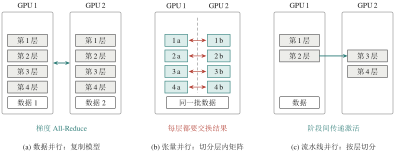
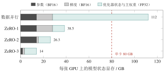

::: {.bookbox .guide}

有了硬件，开发者并不想为每种芯片手写内核、手工推导梯度；模型大到单卡装不下时，也不想从头处理多卡通信。深度学习框架正是为此而生：通用框架（如 PyTorch）提供张量、自动微分、优化器和设备管理，大模型训练框架（如 DeepSpeed、Megatron-LM）在其上增加并行切分与状态分片。这样，同一份模型代码就能在不同硬件和规模下运行，显存与通信的开销也可以事先用公式估算，并据此选择并行策略。

:::

## 4.3.1　为什么需要深度学习框架

深度学习模型由许多层组成，每一层又包含矩阵乘法、激活函数、归一化等基本运算。这些基本运算在不同模型之间高度共性。如果每实现一个新模型都要直接编写设备内核、手工推导梯度，开发成本将难以承受，代码也无法在不同硬件间复用。

**深度学习框架**把这些共性运算封装成标准化组件——张量、算子、自动微分、优化器、设备调度、模型模块和分布式通信——供开发者组合使用^[\[2\]](references.qmd#ref-2)^。这种封装带来两方面的好处：算法开发者能够快速表达和修改模型；系统开发者则可以集中精力，针对具体硬件优化少数热点算子，让所有上层模型同时受益。

使用框架训练一个模型的典型流程是：用张量运算定义模型与损失函数；框架根据计算图自动求出损失对各参数的梯度；优化器按学习率等规则更新参数；所有计算交由下层软件栈和硬件执行。表 [4-3](s4-3.qmd#tab-frameworks) 列出了几类代表性框架。

::: {#tab-frameworks .booktab}

::: {.tabcap}
表 4-3　代表性深度学习框架
:::

  类别             代表                     定位
  ---------------- ------------------------ ------------------------------------------------------------------------
  通用框架         PyTorch、TensorFlow      张量计算与自动微分，开发灵活，生态完整
  大模型训练框架   DeepSpeed、Megatron-LM   基于 PyTorch 扩展，提供大规模并行训练与显存优化
  推理框架         vLLM、SGLang             面向大模型推理服务，侧重缓存管理与请求调度（见第 [4.4](s4-4.qmd) 节）

:::

## 4.3.2　PyTorch：张量、自动微分与编译优化 {#subsec-pytorch}

PyTorch 由 Facebook AI Research（现 Meta AI）于 2017 年开源，前身是 2002 年发布、以 Lua 为接口的 Torch 框架^[\[9\]](references.qmd#ref-9)^。它的三个核心概念是：

**张量**　 `torch.Tensor` 是多维数组，可以存放在 CPU 或 GPU 等设备上，支持类似 NumPy 的运算接口。

**自动微分**　 PyTorch 的 Autograd 系统在前向计算时记录各运算之间的依赖关系，形成**计算图**；调用 `backward()` 时，按链式法则从损失出发反向计算每个参数的梯度。以线性层 $\boldsymbol{y}=W\boldsymbol{x}+\boldsymbol{b}$ 和平方误差损失 $\mathcal{L}=\tfrac12\lVert\boldsymbol{y}-\boldsymbol{t}\rVert_2^2$ 为例，由链式法则可得 $$\frac{\partial\mathcal{L}}{\partial W} = (\boldsymbol{y}-\boldsymbol{t})\,\boldsymbol{x}^{\top},\qquad
  \frac{\partial\mathcal{L}}{\partial \boldsymbol{b}} = \boldsymbol{y}-\boldsymbol{t}.
\tag{4-5}$$ 框架并不显式求解参数，它只是按链式法则计算梯度，再由优化器据此迭代更新参数。大型 Transformer 的训练遵循完全相同的逻辑，只是计算图更大、算子更多。

**动态图与编译**　 PyTorch 默认采用**动态图**（eager execution）：代码逐行执行，计算图在运行时随之构建，因此可以直接使用 Python 的条件与循环，也便于调试。代价是每个算子都要经过 Python 解释器调度，难以做跨算子的全局优化。PyTorch 2.x 引入了 `torch.compile`，可以在运行时捕获计算图，进行算子融合等优化后再编译执行，兼顾动态图的灵活性与静态图的性能^[\[10\]](references.qmd#ref-10)^。

下面是一个完整训练步骤的最小示例，对应上述三个概念：

``` {.python language="Python"}
import torch
model = torch.nn.Linear(1024, 1024).to("cuda")    # 张量与模块放到 GPU
opt = torch.optim.AdamW(model.parameters(), lr=1e-4)
model = torch.compile(model)                       # 可选：图捕获与编译优化
x = torch.randn(32, 1024, device="cuda")
t = torch.randn(32, 1024, device="cuda")
loss = 0.5 * ((model(x) - t) ** 2).sum()           # 前向：记录计算图
loss.backward()                                    # 反向：自动求梯度
opt.step(); opt.zero_grad()                        # 优化器更新参数
```

::: {.bookbox .pitfall}

[辨析]{.boxtitle}

`torch.compile` 并非在所有情况下都能加速。动态变化的张量形状、不受支持的算子、首次编译的耗时以及模型结构本身，都会影响最终收益。是否开启、收益多少，应以实测为准。

:::

## 4.3.3　训练显存：一张卡要装下什么 {#subsec-train-mem}

在决定是否需要分布式训练之前，先要回答一个更基本的问题：一张卡到底要装下什么？答案不只是权重，还包括梯度、优化器状态和激活值。

把它们逐项相加即可。设模型有 $N$ 个参数，每个参数的权重、梯度、优化器状态和主权重副本分别占 $b_w$、$b_g$、$b_o$、$b_m$ 字节，则全参数训练的显存近似为 $$M_{\mathrm{train}} \approx N\,(b_w+b_g+b_o+b_m) + M_{\mathrm{act}} + M_{\mathrm{workspace}},
\tag{4-6}$$ 其中 $M_{\mathrm{act}}$ 为激活值占用，与批大小和序列长度成正比；$M_{\mathrm{workspace}}$ 为临时缓冲区。

::: {#ex-trainmem .bookbox .example}
::: {.boxtitle}
例 4-2　7B 模型的训练显存
:::

当前大模型训练的常见配置是 BF16 混合精度加 Adam 优化器^[\[11\]](references.qmd#ref-11)^：BF16 权重 2 字节、BF16 梯度 2 字节、FP32 主权重 4 字节、Adam 的一阶矩与二阶矩各 4 字节，合计 16 字节/参数。对于 $N=7\times10^9$，仅模型状态就需要 $$7\times10^{9}\times16 = 112\times10^{9}\ \text{字节} \approx 112\,\text{GB},$$ 尚未计入激活值。这已经超过单张 80 GB 显卡的容量。若改用 FP32 权重与梯度、带动量的 SGD（共 12 字节/参数），则约为 84 GB。

:::

可见，显存需求**不是模型的固有属性**，而取决于精度、优化器以及主权重副本的存储方式；引用或计算这类数字时必须说明前提。降低显存的手段主要有三类：混合精度与低精度优化器改变每参数字节数；**激活检查点**（activation checkpointing）在反向传播时重新计算部分中间结果，以额外计算换取激活显存的节省；**参数高效微调**（如 LoRA^[\[13\]](references.qmd#ref-13)^）只训练少量新增参数，大幅减少梯度与优化器状态。当这些手段仍不够时，就需要把模型和状态**切分**到多张卡上。

## 4.3.4　单卡放不下怎么办：分布式训练 {#subsec-parallel}

既然一张卡放不下，最直接的想法就是把模型和训练状态“切开”，分给多张卡。切分对象不同，就得到不同的并行方式（图 [4-7](s4-3.qmd#figure-parallel)）：

-   **数据并行**（Data Parallelism，DP）：每张卡保存完整的模型副本，处理不同的小批量数据，反向传播后通过 All-Reduce 汇总梯度并同步更新。它能提高样本吞吐量，但**不减少**每张卡上的模型状态占用。

-   **张量并行**（Tensor Parallelism，TP）：把同一层内部的矩阵按行或列切开，分给多张卡共同计算^[\[12\]](references.qmd#ref-12)^。单卡显存需求随之下降，但每一层都要交换中间结果，通信非常频繁，因此张量并行通常只在 NVLink 互联的单机内使用。

-   **流水线并行**（Pipeline Parallelism，PP）：把不同的层分配到不同的卡上，形成多个流水线阶段，并让多个微批次交错执行。流水线并行的通信量较小，主要挑战是各阶段负载不均，以及流水线启动和排空时产生的空闲时间（称为**流水线气泡**）。

-   **专家并行**（Expert Parallelism，EP）：在混合专家（MoE）模型中把不同的专家放在不同的卡上，token 按路由结果通过 All-to-All 通信发往对应专家。

::: {#figure-parallel .bookfig}

{width="97.5%" fig-align="center"}

::: {.figcap}

图 4-7　三种基本并行方式的切分对象（以 2 张 GPU、4 层模型为例）。红色箭头表示频繁通信，应放在高带宽链路上

:::
:::

数据并行的冗余问题可以通过**状态分片**来解决。DeepSpeed 的 ZeRO（Zero Redundancy Optimizer）^[\[11\]](references.qmd#ref-11)^在数据并行的基础上，把模型状态切分到 $K$ 张卡上：第 1 阶段（ZeRO-1）只切分优化器状态；第 2 阶段（ZeRO-2）再切分梯度；第 3 阶段（ZeRO-3）连参数也一并切分，计算到某一层时才临时把完整参数收集回来。PyTorch 的 FSDP（Fully Sharded Data Parallel）提供了与 ZeRO-3 类似的功能。

状态分片究竟能省多少显存？以例 [4-2](s4-3.qmd#ex-trainmem) 中每参数 16 字节的配置为例，记优化器状态与主权重合计为 12 字节/参数，在 $K=8$ 张卡上，每张卡的模型状态显存分别为： $$\begin{aligned}
  \text{普通数据并行：} &\ (2+2+12)\,N = 16N, \\
  \text{ZeRO-1：} &\ (2+2+12/K)\,N = 5.5N, \\
  \text{ZeRO-2：} &\ (2+(2+12)/K)\,N = 3.75N, \\
  \text{ZeRO-3：} &\ (16/K)\,N = 2N.
\end{aligned}$$ 对于 7B 模型，对应约 112、38.5、26.3 和 14 GB（图 [4-8](s4-3.qmd#figure-zero)）。

::: {#figure-zero .bookfig}

{width="81.7%" fig-align="center"}

::: {.figcap}

图 4-8　7B 模型在 8 张 GPU 上采用不同 ZeRO 阶段时，每张卡的模型状态显存（BF16 混合精度 + Adam，未计激活值与通信缓冲区）

:::
:::

```{=html}
<div class="widget" data-widget="train"></div>
```

省下的显存并不是免费的。分片越彻底，需要的通信也越多，例如 ZeRO-3 每计算一层都要先把完整参数收集回来。因此，理论上的显存节省比例不能直接等同于实际可用显存的增加或训练速度的提升。实际的大规模训练通常把数据并行、张量并行和流水线并行组合使用（常称为“3D 并行”）：机内用张量并行，机间用流水线并行，最外层再叠加数据并行或 ZeRO，使通信最频繁的切分落在带宽最高的链路上。

## 4.3.5　训练系统的四类瓶颈

把上述讨论归纳起来，大规模训练常遇到四类瓶颈，每一类都有相应的应对手段（表 [4-4](s4-3.qmd#tab-walls)）。

::: {#tab-walls .booktab}

::: {.tabcap}
表 4-4　大规模训练的四类瓶颈与应对手段
:::

  瓶颈     表现                               主要应对手段
  -------- ---------------------------------- -----------------------------------------------------------
  内存墙   模型状态与激活值放不下             混合精度、状态分片（ZeRO/FSDP）、激活检查点、参数高效微调
  计算墙   算子效率低，算力利用率不足         高效内核（如 FlashAttention）、算子融合、编译优化
  通信墙   GPU 频繁等待数据传输               并行策略与拓扑匹配、通信与计算重叠、高速互联
  工程墙   配置复杂，故障频发，难以稳定运行   检查点保存与恢复、监控与日志、自动化调参工具

:::

::: {.bookbox .keypoints}

[本节要点]{.boxtitle}

-   框架通过张量、自动微分和优化器，把“定义模型”与“执行计算”分离开来。

-   训练显存可按式 [（4-6）](s4-3.qmd#eq-train-mem) 估算；结果取决于精度与优化器，必须写明前提。

-   数据并行切分数据，张量并行切分层内矩阵，流水线并行切分层，ZeRO 切分模型状态；省显存往往以多通信为代价。

:::
