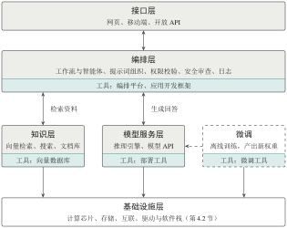

::: {.bookbox .guide}

只有模型还算不上产品：它要部署运行，要连接外部知识，要嵌入业务流程，有时还要针对特定任务微调。每个环节都从零搭建显然不现实。本节按“负责哪一段链路”把常用工具分为部署工具、微调工具、向量数据库、应用开发框架和编排平台五类，它们各司其职、组合使用。选型时，先确定需求落在哪一段链路，再在同类工具之间比较。

:::

## 4.5.1　一个大模型应用由哪些部分组成

下面以一个企业内部的知识问答助手为例。用户在网页上提问后，系统需要依次完成以下步骤：判断用户身份和权限，从内部文档中检索相关资料，把问题和资料组织成提示词并交给模型生成回答，把带有引用出处的回答返回给用户，并记录日志以便评估和改进。其中，“运行模型”只是一个环节。

图 [4-11](s4-5.qmd#figure-app-arch) 给出了这类应用的典型分层：**接口层**负责与用户交互；**编排层**负责流程控制、权限校验、工具调用与安全审查；**知识层**提供向量数据库、搜索引擎和文档来源；**模型服务层**由推理引擎运行模型并提供 API；**基础设施层**即第 [4.2](s4-2.qmd) 节介绍的算力资源。这一分层是对常见组织方式的归纳，并非所有产品都必须恰好分为五层。

::: {#figure-app-arch .bookfig}

{width="77.9%" fig-align="center"}

::: {.figcap}

图 4-11　大模型应用的典型分层与五类工具的位置。每个框底部的色带标出该层对应的工具类别。编排层发起检索与模型调用；微调（虚线框）在线下进行，产出的权重交给模型服务层加载

:::
:::

## 4.5.2　五类工具的定位 {#subsec-tool-types}

根据所负责的链路，常用工具可分为五类（表 [4-6](s4-5.qmd#tab-tools)）。需要注意，这是按**功能定位**划分的分类，而非严格互斥的技术分类：许多产品同时具备多种能力。例如，某个部署工具既能管理模型，也能对外提供 API；某个编排平台既能搭建知识库，也能集成智能体。选型时应先明确工具负责哪一段链路，再比较具体产品。

::: {#tab-tools .booktab}

::: {.tabcap}
表 4-6　五类应用系统工具的定位
:::

  类型           代表工具                                              主要功能                                   容易混淆之处
  -------------- ----------------------------------------------------- ------------------------------------------ ------------------------------------
  编排平台       Coze、Dify、FastGPT、MaxKB                            可视化搭建工作流、接入知识库、发布应用     不是训练或计算框架
  应用开发框架   LangChain、LlamaIndex、LangGraph                      以代码连接模型、工具与数据，实现控制逻辑   不提供算力，也不运行模型
  向量数据库     Milvus、Faiss、Pinecone、Weaviate                     向量存储、近似最近邻检索、元数据过滤       只负责检索，不能代替模型生成回答
  微调工具       LLaMA-Factory、Transformers + PEFT、XTuner、Unsloth   组织数据与训练配置，支持 LoRA 等方法       与驱动、编译器不在同一层
  部署工具       Ollama、LM Studio、vLLM、SGLang、TGI                  加载模型、执行推理、提供 API               “方便运行”与“高并发吞吐”是不同目标

:::

## 4.5.3　部署工具：本地运行与高并发服务 {#subsec-deploy}

部署工具可以按目标分为两类。

**面向易用的本地运行工具**　 **Ollama** 是开源的跨平台工具，一条命令（如 `ollama run <模型名>`）即可下载并运行模型，提供兼容 OpenAI 格式的 REST API，并通过量化等手段使模型能够在个人电脑的 CPU 或 GPU 上运行。**LM Studio** 则提供图形界面，便于浏览、下载和试用模型。这类工具降低了模型部署运行的门槛，但它们不会改变模型的参数量和知识截止时间，也不会提升模型本身的能力。部分工具支持导入在其他工具中微调好的权重，但这并不等于工具本身完成了微调训练。

**面向吞吐的推理引擎**　 **vLLM**、**SGLang**、TGI 等推理引擎面向多用户在线服务，其核心是第 [4.4.3](s4-4.qmd#subsec-infer-opt) 小节介绍的技术：PagedAttention 管理 KV 缓存，连续批处理调度请求，并集成高效注意力内核与量化支持^[\[16\]](references.qmd#ref-16)^。llama.cpp 则以 C/C++ 实现、对 CPU 和消费级硬件友好，常作为本地工具的底层引擎。

二者的取舍可以概括为：面向个人体验、离线开发和小规模试用时，优先考虑易用的本地工具；面向多用户并发、关注吞吐与尾延迟的生产服务时，应选用推理引擎，并按第 [4.4.4](s4-4.qmd#subsec-metrics) 小节的方法实测。

## 4.5.4　编排、检索与微调工具

**编排平台与应用开发框架**　 **LangChain** 等应用开发框架以代码形式连接模型、工具和数据源，用“链”或“图”组织多步流程；**Coze**、Dify 等低代码平台则通过可视化节点搭建问答、审批和知识库等业务流程。流程设计中有一个重要的权衡^[\[19\]](references.qmd#ref-19)^：对于步骤固定、重复执行的任务，采用预先定义的**工作流**（workflow）更便于测试和管控；对于目标多变、步骤难以预先确定的任务，可引入能够自主选择工具、规划步骤的**智能体**（agent），同时必须设置权限边界和停止条件。智能体并非自主性越高越好，自主性越高，出错的代价和外部副作用通常也越大。

**向量数据库与检索增强**　 在检索增强生成（RAG）应用中，文档先被切分成片段，用嵌入模型转换为向量后存入向量数据库；用户提问时，系统检索与问题最相似的片段，交给模型参考作答。**Milvus** 是开源的分布式向量数据库，支持海量向量与元数据的存储、多种索引和相似性检索，采用存储与计算分离的云原生架构^[\[18\]](references.qmd#ref-18)^；Faiss 则是一个向量相似性检索**库**，需要嵌入到其他系统中使用，在部署和扩展方式上与完整的数据库不同。需要注意，向量相似并不等于事实正确，实际系统通常还要结合关键词检索、重排序、文档权限控制和回答评估。

**微调工具**　 **LLaMA-Factory** 等工具将数据处理、训练配置、LoRA/QLoRA 等参数高效微调方法^[\[13\]](references.qmd#ref-13),[\[14\]](references.qmd#ref-14)^以及评估导出集成在一起，并提供网页界面，降低了实验管理的门槛。但它们仍然依赖底层框架和硬件，并不会消除优化器状态和激活值带来的开销。要判断一个微调任务能否在单卡上完成，仍需按第 [4.3.3](s4-3.qmd#subsec-train-mem) 小节的方法，根据显存、量化方式、训练精度、批大小和序列长度进行估算。

::: {.bookbox .pitfall}

[辨析]{.boxtitle}

“先微调还是先做 RAG”取决于要解决的问题。如果痛点是知识需要频繁更新、回答需要给出出处，RAG 通常是成本更低的起点；如果痛点是输出风格、特殊格式或特定任务行为，才进一步考虑微调。二者也可以结合使用。

:::

::: {.bookbox .keypoints}

[本节要点]{.boxtitle}

-   “运行模型”只是大模型应用的一个环节，完整的产品还需要接口、编排、知识和基础设施。

-   五类工具按负责的链路区分；选型时先确定链路，再比较产品。

-   本地运行工具追求易用，推理引擎追求吞吐；工作流追求可控，智能体追求灵活。

:::
